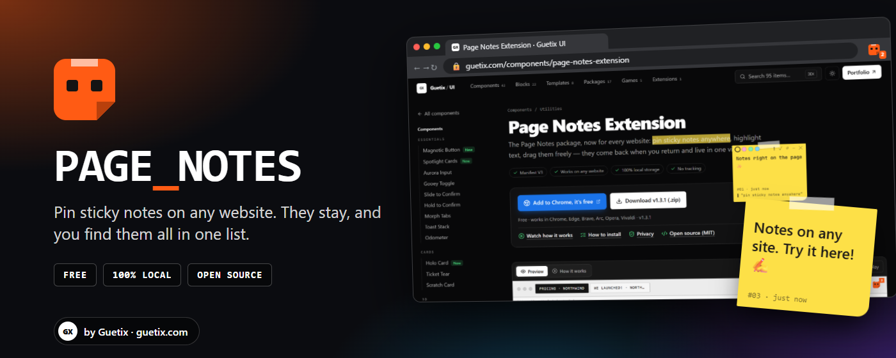
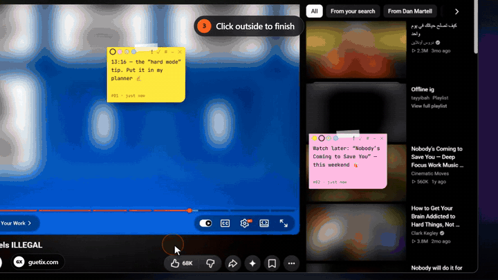
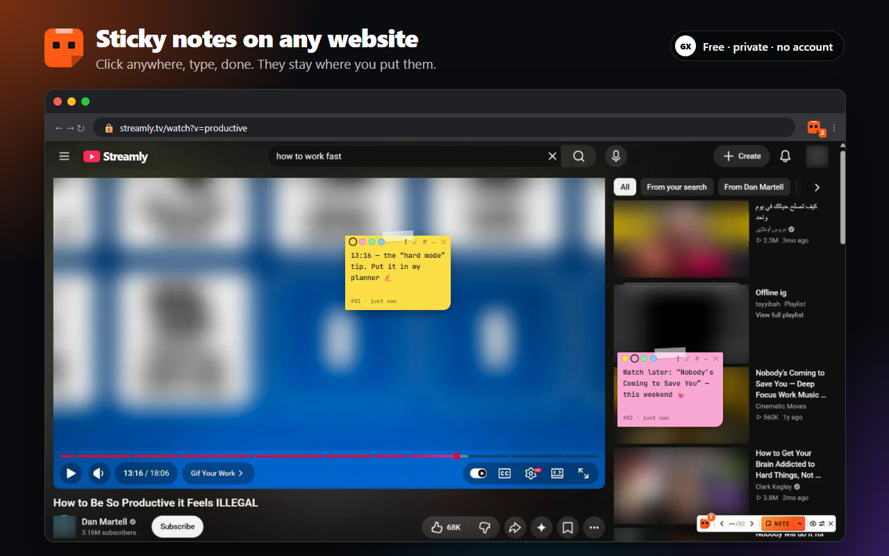
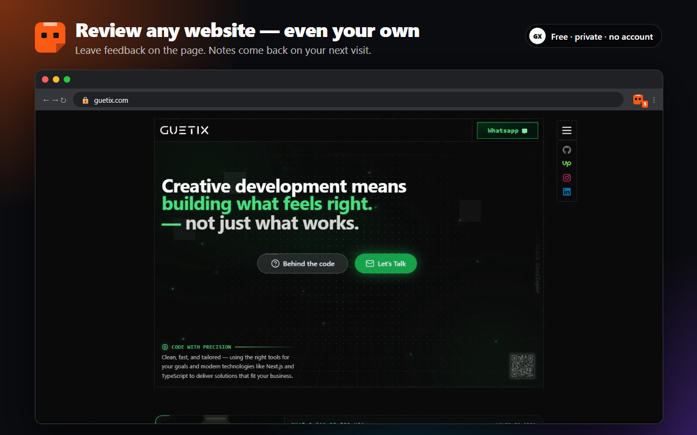
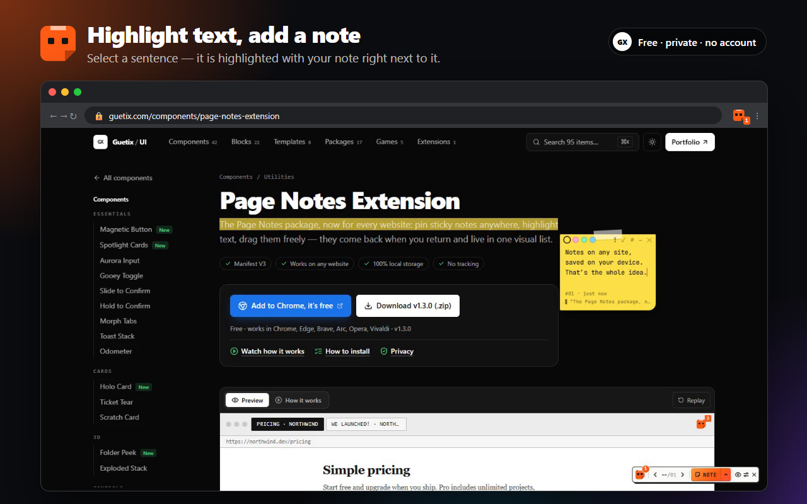
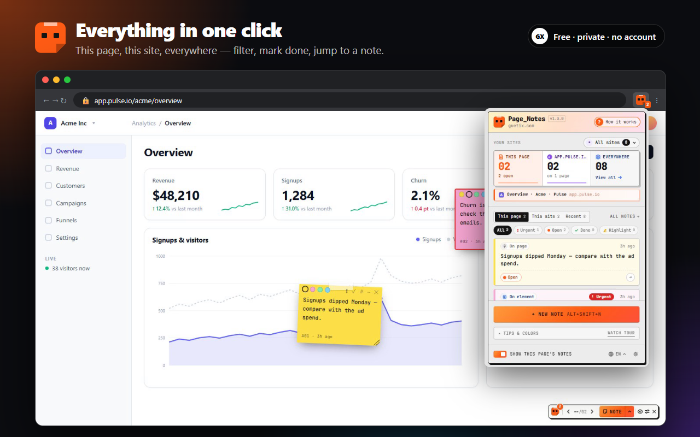

<p align="center"></p>

# Guetix Page Notes

**Sticky notes on any website.** Pin a note anywhere, highlight text, stick a note to a button or a card — it stays
on the page and comes back every time you return. All your notes live in one visual list. Everything is saved in
your browser: no account, no server, no tracking.

[**Add to Chrome — free**](https://chromewebstore.google.com/detail/odjgbkgepfbfmjebffcohkkheonhhdcm) ·
[▶ Watch on YouTube](https://www.youtube.com/watch?v=jKS0PORwXZo) ·
[All tutorials](https://guetix.com/components/page-notes-extension#how-it-works) ·
[Website](https://guetix.com/components/page-notes-extension) ·
[Privacy](PRIVACY.md)

<p align="center"></p>

## Watch how it works

[](https://www.youtube.com/watch?v=jKS0PORwXZo)

2-minute tour: install, pin notes, drag one off the toolbar, highlight text, stick a note to an element, the extension
bar, All notes and Settings. More short tutorials (toolbar, note options, All notes, Settings) on
[guetix.com](https://guetix.com/components/page-notes-extension#how-it-works).

## Features

- **Notes anywhere** — click the toolbar icon → **+ New note** → click the spot → type. Or drag a note straight off the
  on-page toolbar.
- **Three kinds of notes** — a free *Note*, a note stuck to an *Element* (follows it when the layout changes,
  <kbd>Alt+Shift+E</kbd>), or *Text*: select words to highlight them with a note next to them (<kbd>Alt+Shift+L</kbd>).
- **On every note** — 4 colors, urgent, done, copy a link to the note, fold into a tab, move, resize, delete with Undo.
- **On-page toolbar** — note count, ‹ › to step through notes, note type menu, hide this page's notes
  (<kbd>Alt+Shift+H</kbd>), options; draggable, snaps to a side, can be minimized or closed.
- **Extension bar (popup)** — this page / this site / everywhere, your sites, recent notes, quick filters, mark done,
  jump to a note, show/hide per page, 10 languages.
- **All notes** — every note from every site as a card with a snapshot of where it sits: search, filter, sort, edit,
  select several, share or download as Markdown, export / import a JSON backup.
- **Settings** — when notes appear, toolbar style, tips and guide, language, snapshots, shortcuts, your data.

| | |
|---|---|
|  |  |
|  |  |

## Install

- **Chrome Web Store:** [Guetix Page Notes](https://chromewebstore.google.com/detail/odjgbkgepfbfmjebffcohkkheonhhdcm)
  (Chrome, Edge, Brave, Arc, Opera, Vivaldi).
- **From source:** clone this repo → open `chrome://extensions` → turn on **Developer mode** → **Load unpacked** →
  pick the `extension/` folder.
- **Zip:** download `guetix-page-notes.zip` from the [latest release](../../releases/latest), unzip it, then *Load
  unpacked* as above.

## Development

Plain JavaScript (Manifest V3) — no framework, no bundler, no dependencies.

```
extension/
  manifest.json   permissions, shortcuts, popup
  background.js   service worker: shortcuts, context menu, badge, snapshots, fonts
  content.js      notes + toolbar on the page (closed Shadow DOM, so sites can't restyle or read it)
  popup.html/js   the extension bar
  notes.html/js   "All notes" + Settings (notes.html#settings)
  shared.js       storage helpers shared by every part
  i18n.js         10 languages (popup + settings)
scripts/build.mjs draws the icons and packs extension/ → dist/guetix-page-notes.zip
```

```bash
npm run build      # Node 18+; writes dist/guetix-page-notes.zip
```

Edit a file, then click ↻ on the extension in `chrome://extensions` and reload the page you are testing.
See [CONTRIBUTING.md](CONTRIBUTING.md).

## Privacy

Notes, highlights and snapshots are stored with `chrome.storage.local` on your device. The extension has no server,
no account, no analytics and makes no network requests of its own. Details: [PRIVACY.md](PRIVACY.md).

## License

[MIT](LICENSE) © Hamza Guetioui — [guetix.com](https://guetix.com).
Bundled fonts (Pixelify Sans, JetBrains Mono) are under the SIL Open Font License — see `extension/fonts/LICENSE.txt`.
